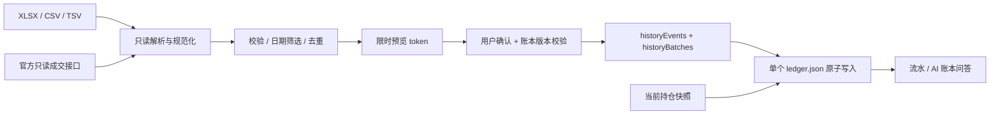

# ADR: 历史流水回补（0.5.0）

状态：本地实现；文件与模拟官方 SDK 验证，真实授权账户仍需联调。用户要求已导入账户随时补历史，并提供同花顺投资账本 Excel 作为适配样例。

## 交互与范围

入口为「流水 → 补充历史流水」、数据源中已导入账户的补充按钮和「历史回补」页。选择已有账户后，上传 XLSX / CSV / TSV 或选择可用的官方接口，设置日期、核对预览，再确认导入。历史回补不创建或重新绑定账户，不改变原有「登录 → 选择来源账户 → 导入当前持仓」流程。

文件未填写日期范围时读取全部可识别流水；官方接口须明确日期。预览展示新增、重复、冲突、范围外条数、各业务类型与实际记录跨度。文件中最早/最晚记录不是完整覆盖证明：无流水的一天、被省略的业务和缺失区间无法仅凭账单推断。导入不构造历史净资产、不补造期初买入或现金，也不把资产趋势当收益率。

## 数据与事务

- `history-file.mjs` 仅解析；`history.mjs` 仅归档；`history-provider.mjs` 只读取券商。生产 XLSX 解析使用独立 Node 依赖，不调用 Python 或其他 DSH 插件。
- 旧版 `trades` 保留，新增 `historyEvents` 保存全部历史业务，流水页面合并显示。归档不创建当前持仓标的、不运行 trade.add、不回放数量或现金，也不因历史卖出缺少先前买入而拒绝有效记录。
- 规范化字段包括 date、time、kind、originalType、symbol、market、currency、qty、price、grossAmount、cashAmount、fee、externalId、note、sheet、row；保存后添加 accountId、provider、batchId、importedAt 和 archiveOnly。
- 保存原始业务名称和表格行号用于追溯。未知业务保留为 other 并告警；未知费用和未知现金为 null，不填零。发生金额保留正负号；不从净额重复扣手续费。回购 price 是报价利率，不能以数量乘利率替换原金额。
- 币种来自文件明确列或用户选定的缺省币种；不根据五位港股代码推断金额单位。选定币种仅标注原值，不执行换汇。混合币种账单应包含每行币种列，不能把整份文件混标为一个单位。
- 预览不落盘。服务端最多保留 5 份、10 分钟有效的不可变草案；客户端确认只发 token，不能替换行或 accountId。提交使用整本账本散列检查版本；期间变化须重新预览。一次 JSON 原子写同时保存记录与批次；写入失败不改当前内存账本。重复提交同一个成功 token 复用结果，不追加第二批。
- 上传解码最多 5MiB，最多 25000 条。XLSX ZIP 预检限制条目、总解压体积、加密/宏/异常结构；不落地解压路径。HTTP 历史请求单独限制 8MiB，容纳 base64 开销。PDF、OCR、旧式 XLS、加密或宏工作簿暂不支持。

## 去重与冲突

优先使用已有本地账户 + 来源 + 业务类型 + 独立成交编号；账户本身已区分富途环境和来源身份。使用 fillID/tradeId，不使用订单号替代成交编号，因为一个订单可能多次成交。同编号经济字段发生变化时作为冲突拦截，不静默覆盖成交撤销或修正。

无编号时采用日期、完整成交时间、业务、标的、市场、币种、数量、价格、发生金额、成交金额、费用的指纹，并按相同记录的出现次数匹配。两条真正完全一致的无编号成交仍保存两条，重复导入同一文件不会继续增加；重叠文件保留最大可见笔数。跨来源的精度、费用或时间缺失不一致时不能可靠判重，预览明确提示人工核对。旧版缺少时间/金额的流水也存在这一局限，不声称跨任意格式完全自动匹配。

## 来源能力与证据

| 来源 | 当前回补 | 不能据此声称 |
|---|---|---|
| 同花顺投资账本 | 官方「资金流水」接口（get_money_history）：股票账本为买卖、回购、派息、缴税、新股/配债入账，基金账本（爱基金/理财）为申购、定投、赎回、分红、转入/转出；另适配含交易记录工作表的 Excel 及 CSV/TSV | 银证转账等银行侧记录不在接口内；持仓接口不能推导历史成交；接口金额恒为正数，方向按业务类型判定；基金流水常无 vid，按经济要素+次数弱去重 |
| 富途 | OpenD 真实账户历史成交，核验账户/环境/市场，订单元数据确定币种；官方 MCP 另行读取 account_fills_history（按市场分页）+ account_cash_logs（出入金、股息、利息、费税），deal_id 作成交编号、cash_change 已带符号 | 没有完整资金/分红历史（MCP 现金流水可补一部分）；模拟账户 OpenD 接口不支持；未提供费用不等于零；MCP 无标的资金流水需资金币种或多市场推断 |
| 长桥 | 官方 MCP（授权码兑换 Token）：history_executions 成交 + cash_flow 资金流水（出入金、股息、利息、费用、税）；SDK 路径为分段历史成交 + 当日成交，订单详情确定方向/币种 | 单次 SDK 结果不是无限分页；不同通道无法拆分时拒绝；MCP 资金流水无业务编号，按经济要素+次数弱去重；成交行缺币种时按市场推断并告警 |
| IB | 可识别格式的成交/资金 CSV/TSV 文件 | 现有 Gateway 持仓授权不是 Flex 授权；未实现自动 Flex、XML 报告或所有可选 CSV 布局 |

富途历史接口无文档化 cursor，日期必须明确。文档中的 90 天为省略参数时的默认范围，不宣称历史最多 90 天。读取遵守请求预算，校验响应头及大整数 ID；有成交修正、空头或不支持的业务时明确失败，改用核对后的账单。费用是订单级总额，当前逐笔成交费用保留未知，不把总费用复制到每次部分成交。

富途官方 MCP 历史（`fetchFutuMcpHistory`）：按授权账户 `enable_market` 逐市场调用 `account_fills_history`（`page_size` 上限 50、`page_flag` 游标），`trd_side` 仅 BUY/SELL，其他（SELL_SHORT/BUY_BACK 等）跳过并告警，`status` 非 OK 跳过，`deal_id` 作时间序列号，`create_time` 为 int64 微秒；另分页读取 `account_cash_logs`（`page_size` 上限 20），按 `transaction_name` 关键词映射分红/利息/费用/税/存取，`cash_change` 已带符号直接作 cashAmount，成交类流水跳过避免与成交本金重复计算；无标的的资金流水按 `source.currency` 或单一市场推断币种并告警。上述均为只读，未授权时提示重新浏览器授权（401）或权限不足（403，需 `trade:read`/`quote:read`）。

长桥官方 HTTP 有 1000 条上限；安装的 SDK 4.3.7 丢弃 has_more。达到上限时递归拆分时间窗、按成交编号去重；单秒仍饱和或超过调用预算时停止并要求缩小范围，不能推进完整覆盖水位。历史接口不包含当日，按需合并当日成交。多通道无法归属时不强行写入单一账户。订单总费用不分摊到部分日期/部分成交。

长桥 MCP 路径（`lb-mcp.mjs`）通过官方 Streamable HTTP MCP（`https://mcp.longbridge.com`）调用 `history_executions`（服务端自动翻页，`trade_id` 为唯一键）与 `cash_flow`（In/Out 方向 + 业务类型映射为 dividend/interest/fee/tax/deposit/withdrawal/other；无业务编号的行用弱键去重）。授权码兑换走 `/agent` 会话的 `authenticate` 工具，Token 由插件本地加密保存；错误 403308 表示权限范围未授予，需在长桥授权页重新勾选资产只读权限。

同花顺样例包含「持仓数据」「已清仓」「交易记录」。优先选择「交易记录」，其余为快照或汇总，不能合并当作成交流水。样例涉及买卖、银证转账、分红、股息税、回购、新股及股份转移，均需保存；不把所有记录硬转为买卖。

同花顺官方资金流水接口（pc/account/v2/get_money_history）经用户提供的真实会话验证：POST 表单含 fund_key（账本 id）、start_date/end_date（YYYYMMDD）、page/count（≤200），按 max_page 分页可取全量历史。响应行字段为字符串，entry_money 恒为正数，现金流方向由 op 决定：1 买入/5 回购开仓/235 配债买为流出，2 卖出/35 回购平仓/236 配债卖为流入，6 派息流入，95 缴税流出，222 入账无现金流；未知类型保留原始名称并记流水方向未知。vid 为稳定唯一编号，作为去重主键（派息/缴税/入账的 trans_no 为空）。币种固定 CNY；银证转账等银行侧记录不在该接口内，用文件补录。该结论基于 482 条真实流水（2020-12-22 至 2026-11-04）核对，不对外承诺接口稳定性。

同花顺基金账本（爱基金 ijj 用 `custid`、手动理财 manFund 用 `fundid`，二者互斥）共用同一资金流水接口，account_type 为 `4`(manFund)/`5`(ijj)，op 语义不同于股票：0 申购/1 定投为买入流出，2 现金分红为流入，4 赎回为卖出流入，10 转入/11 转出为基金转换两腿、现金中性记 0，100 修改持仓为手动修正、现金未知记 null。基金流水通常没有 vid/trans_no，去重改用「日期+op+代码+金额+份额+价格+费用+出现次数」的弱键，重复拉取保持稳定、同值多笔不合并。该结论经真实基金账本（爱基金 24 只持仓、账户总资产 115116.34、总成本 141202.55）与历史流水探测核对；费用口径以流水标注为准，未推断毛/净额。

IB 可后续独立接入 Activity Flex：用户自行创建查询及令牌，不能复用 Gateway Cookie。官方 Web Service 单请求日期覆盖最多 365 天；令牌限速每秒 1 次、每分钟 10 次，需识别 HTTP200 中的错误/生成中 XML。当前年度及前四个日历年的报告可用范围与单次 365 天限制是不同概念。Trades 报告应选择 Executions，不能把订单/标的/批次汇总重复当成交；资金、分红及公司行动还需相应报告章节。

参考：

- [同花顺交易数据文件指引](https://tzzb.10jqka.com.cn/m/datateachinfo.html)
- [富途历史成交](https://openapi.futunn.com/futu-api-doc/en/trade/get-history-order-fill-list.html) / [结构](https://openapi.futunn.com/futu-api-doc/en/trade/trade.html) / [订单费用](https://openapi.futunn.com/futu-api-doc/en/trade/order-fee-query.html)
- [长桥历史成交](https://open.longportapp.com/docs/trade/execution/history_executions) / [当日成交](https://open.longportapp.com/docs/trade/execution/today_executions) / [订单详情](https://open.longportapp.com/docs/trade/order/order_detail)
- [IB Flex 配置](https://www.ibkrguides.com/clientportal/performanceandstatements/flex3.htm) / [限速与错误](https://www.ibkrguides.com/clientportal/performanceandstatements/flex3error.htm) / [可用历史](https://www.ibkrguides.com/clientportal/performanceandstatements/flex.htm) / [成交字段](https://ibkrguides.com/reportingreference/reportguide/tradesfq.htm)

## API

- GET `/portfolio/api/history/capabilities`：当前账户的接口可用性、原因及文件限制，不含凭据。
- POST `/portfolio/api/history/preview`：`{accountId,method:'file'|'api',from?,to?,text?,fileBase64?,fileName?,sheet?,defaultCurrency?}`；返回 token、只读行/错误/警告、去重统计、工作表及范围。
- POST `/portfolio/api/history/commit`：`{token}`；返回 ledger、summary 与 imported/duplicates/outside/batchId。不存在行级覆盖、回放持仓或隐式创建账户参数。

定时持仓同步仍只刷新快照。历史回补目前由用户选择日期后预览确认，不把后续后台成交增量或历史资产估算冒充为已完成。
