<p align="center">
  
</p>

<p align="center">
  <b>券商、基金、生活账单，装进一个本机账本。</b><br>
  让 AI 直接读它、改它、替你核对它。
</p>

<p align="center">
  <a href="https://wealth.nickszy.com"></a>
  
  
  
</p>

<p align="center">
  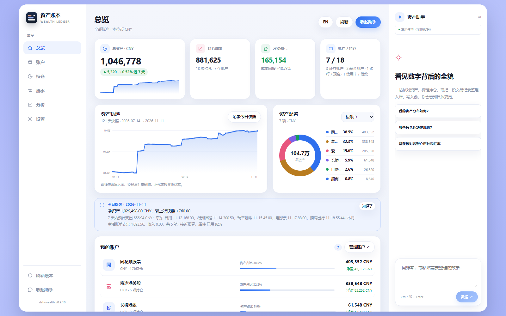
</p>

---

## 一句话

**dsh-wealth 是一个跑在 [DeepSeek Harness](https://github.com/deepseek-ai) 里的个人资产账本插件。**
一次授权，自动同步同花顺、富途、长桥、且慢、老虎、复星与 IB 的账户、持仓和流水；
导入微信 / 支付宝账单补齐生活支出；然后用同一份本机数据看总资产、算真实收益、让 AI 帮你核对。

- **不用 Excel，也不用把券商密码交给云端。** 账本和凭据只在你自己的电脑上。
- **不是又一个行情软件。** 它回答的是：「我到底有多少钱、这些钱从哪来、最近花到哪去了。」
- **不是一个只会聊天的机器人。** 助手读的是你真实的账本，改动会先给你看草案，确认后才写入。

## 30 秒开始

1. 在 DSH 的插件页搜索 **`dsh-wealth`** 安装（或 `dsh plugin add dsh-wealth`），重启 DSH。
2. 打开「资产账本」→ 右上角 **资产助手旁的三步引导**，或直接进入 **账户 → ＋ 新增账户**。
3. 选一家券商 → 完成一次登录 / 扫码授权 → 勾选要导入的子账户。之后每天自动同步。

> 只想先试试？选「手工添加」记一笔，或用「文件导入」传一份 CSV，不用连接任何券商。

## 它长什么样

### 一个总览，看清全部家底

总资产、持仓成本、浮动盈亏、账户和币种分布；资产轨迹来自真实历史快照，
不是根据当前持仓倒推的示意图。

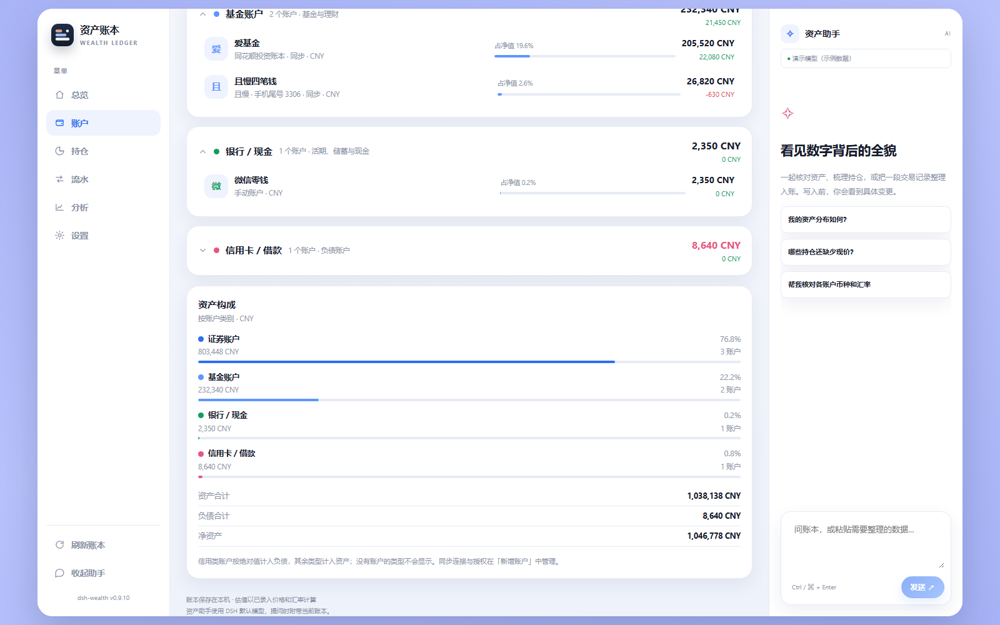

### 一次登录 = 一条授权，而不是一堆散落的账户

同一券商登录一次，就能看到它下面所有子账户，分批导入、随时重命名或重新授权。
富途、长桥、且慢、老虎、复星都走各自官方的 OAuth / MCP 授权，插件不接触密码。

<p>
  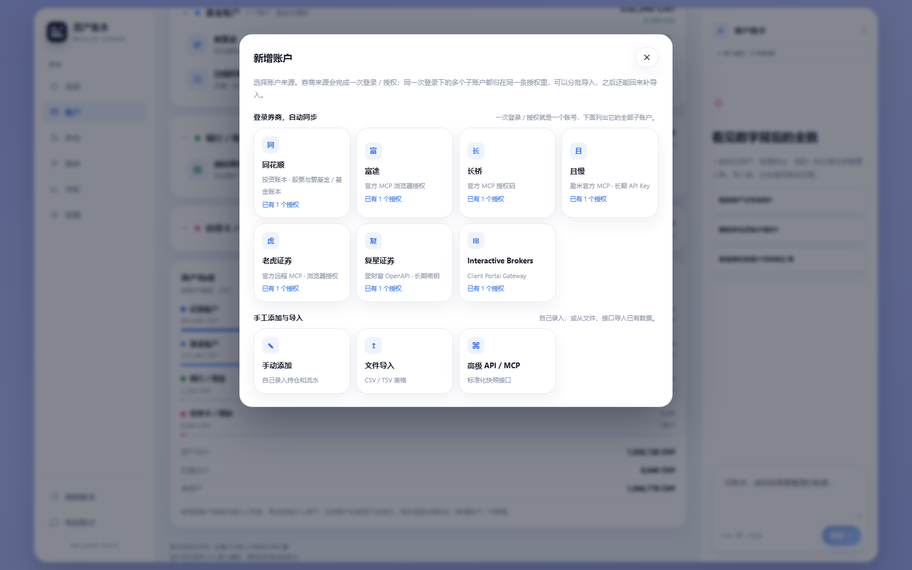
  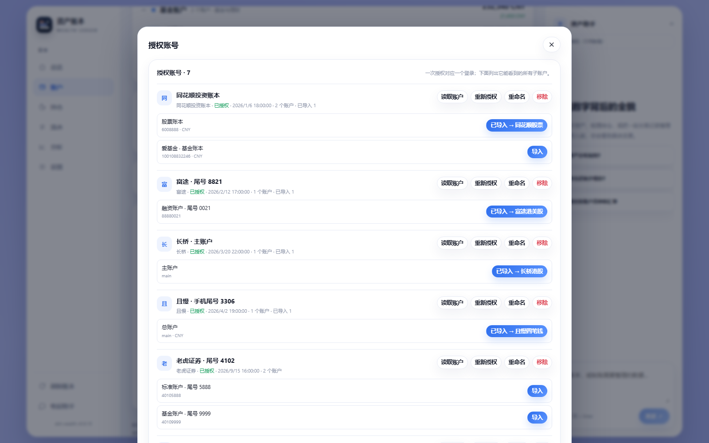
</p>

### 不只是「持仓值多少钱」，而是「我到底赚了多少」

分析页同时给出 **时间加权收益 TWR**（剔除出入金影响，可跨账户比较）和
**资金加权年化 XIRR**（你自己的真实年化），外加最大回撤、资金流总览、
资产负债表，以及按行业 / 风格的集中度。

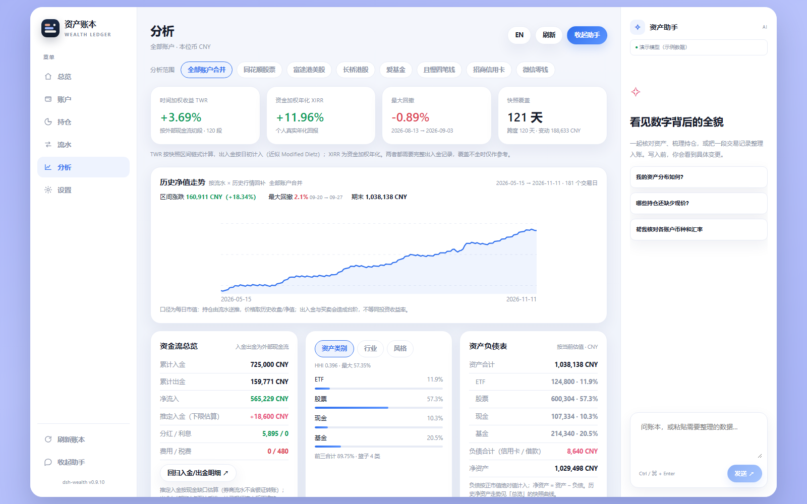

单账户还能把流水和历史行情拼回去，看到**买入以来**的净值走势与回撤，
而不是「从安装那天起」的曲线。

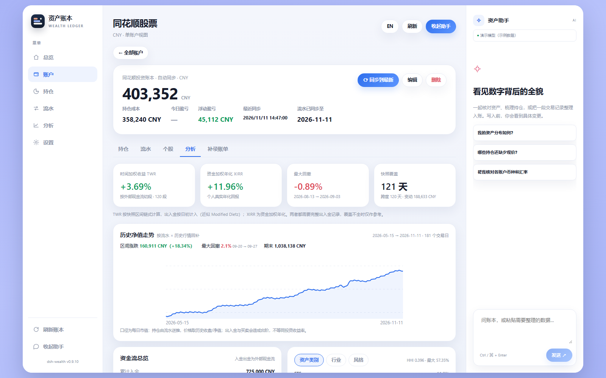

### 投资和生活，记在同一本账上

导入微信 / 支付宝 CSV，自动按餐饮、交通、居住、购物等分类；
月度预算、超支提醒、年度现金流，和投资收益放在同一套数据里，
不再出现「投资账本很漂亮，但不知道钱花哪了」。

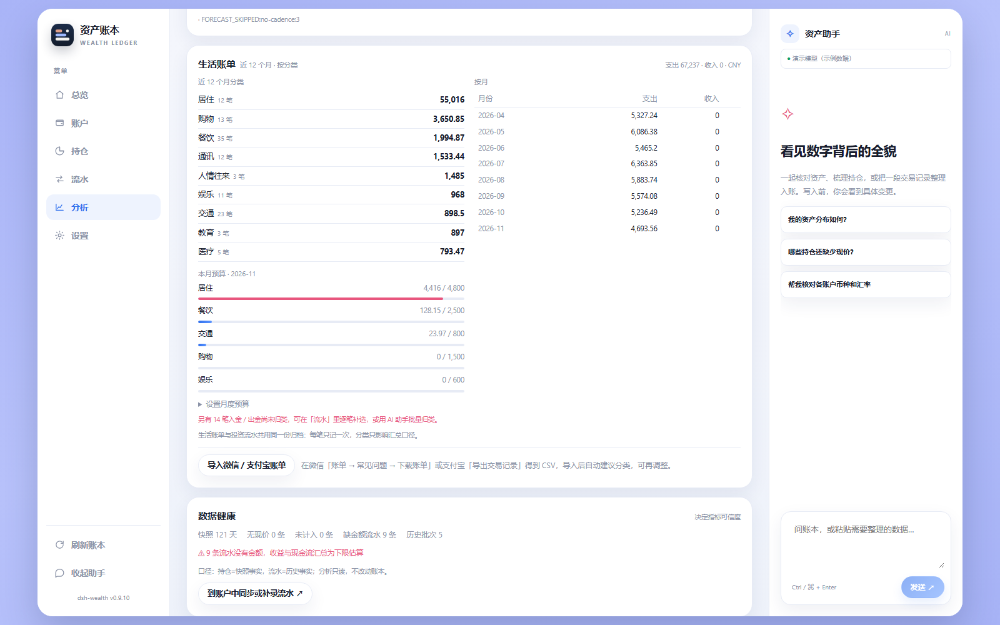

### 一个真的能动手的 AI 助手

右侧助手用的是 DSH 默认模型，每次提问都会带上当前账本。
它可以改价格、补录流水、建预算、整理一段粘贴进来的交易记录——
所有改动先以「待写入 N 项变更」展示，点确认才落盘，落盘前还会校验账本版本。

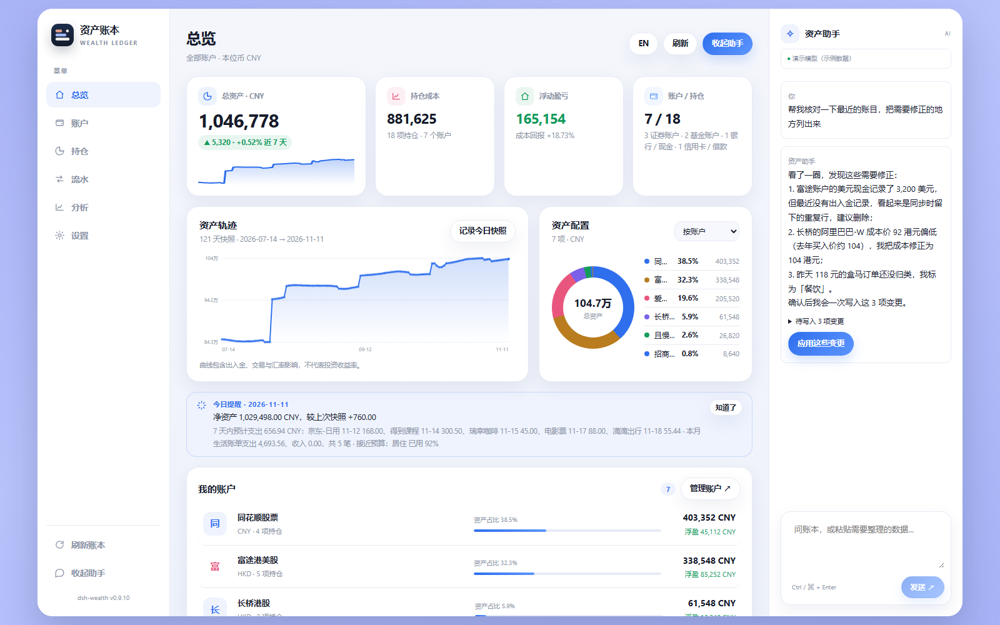

### 持仓、流水、设置都在该在的位置

<p>
  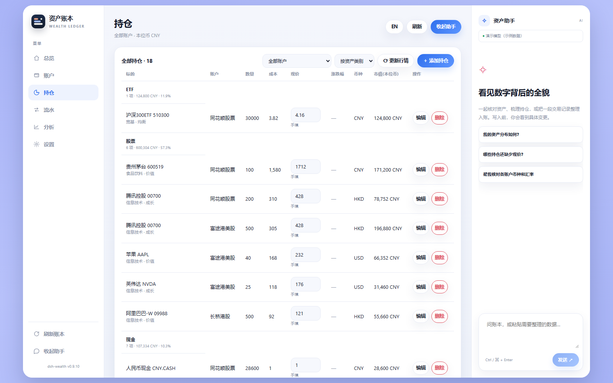
  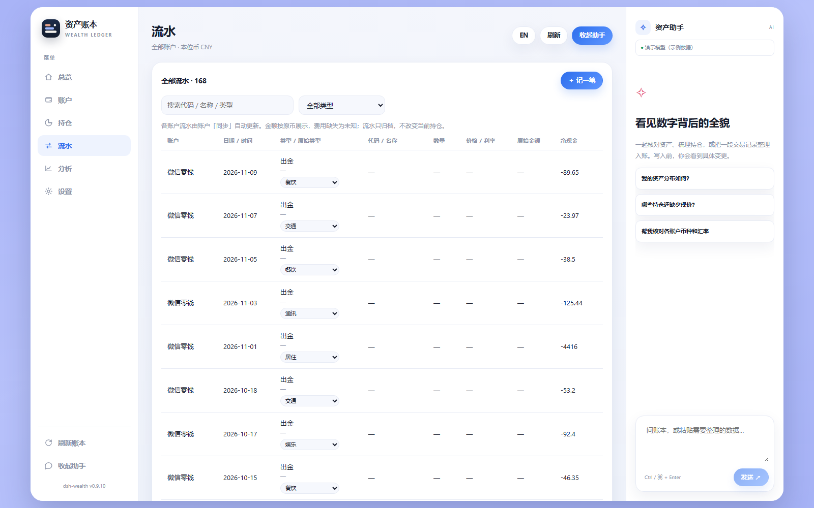
</p>

<p align="center">
  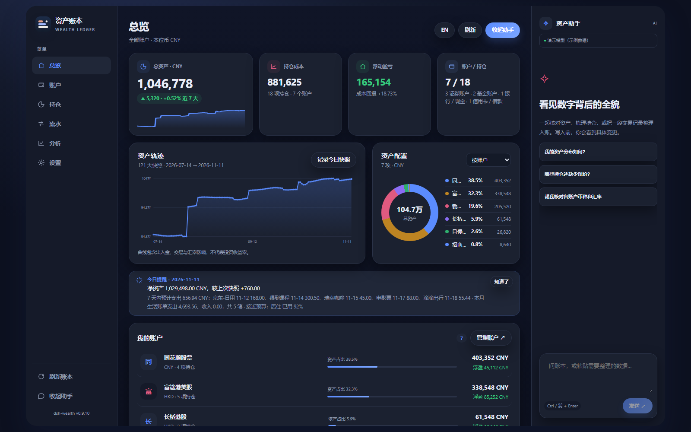
</p>

> 以上截图由 `scripts/demo-fixture.mjs` 生成：**真实界面 + 真实计算管线 + 虚构演示数据**，
> 不含任何真实账户信息。随时可以自己重新生成。

## 支持的数据源

| 来源 | 接入方式 | 能读到什么 |
|---|---|---|
| **同花顺投资账本** | 官方远程 MCP，一键 OAuth 授权 | 股票账本、爱基金 / 基金账本、持仓、成本、资金流水、银证转账 |
| **富途** | 官方 MCP 浏览器授权，或本机 OpenD | 账户、持仓、现金、历史成交与资金流水 |
| **长桥** | 官方 MCP 授权码，或 OpenAPI 凭据 | 股票 / 基金持仓、余额、成交与流水 |
| **且慢（盈米）** | 官方 MCP，用户级 OAuth | 总账户与四笔钱子账户、市值、收益 |
| **老虎证券** | 官方远程 MCP，浏览器授权 | 账户、资产、持仓、历史订单 |
| **复星证券 / 星财富** | 官方 OpenAPI，App 扫码开通 | 交易账户、现金汇总、持仓、资金流水 |
| **Interactive Brokers** | 本机 Client Portal Gateway | 账户、持仓、原币现金 |
| 手工 / 文件 / 高级 API·MCP | 内置 | CSV / XLSX、标准快照接口，兜底任何来源 |

连接一次后每天 **21:00** 自动同步（时间可改，也可设为仅手动）。
历史流水按需回补，行情数据缓存在本机，只增量更新。

## 隐私与本地优先

- 账本：`%USERPROFILE%\.dsh\data\dsh-portfolio\ledger.json`，原子写入并保留 `.bak`。
- 凭据：同目录 `credentials.enc.json`，**AES-256-GCM** 加密；API 和界面永不返回原值。
- 同步只走你自己配置的券商官方接口；没有中转服务器，没有账号体系。
- 其他 DSH 会话或本机脚本可以用 `node cli.mjs` 读取同一份账本（只读查询 / 显式写入）。

## 和别的工具有什么不同

|  | dsh-wealth | Ghostfolio | Portfolio Performance | 随手记 / MoneyWiz |
|---|---|---|---|---|
| 中国市场券商直连（同花顺 / 富途 / 长桥…） | ✅ | ❌ | ❌ | ❌ |
| 微信 / 支付宝账单 + 生活分类 | ✅ | ❌ | ❌ | ✅ |
| 投资与记账共用一份账本 | ✅ | ❌ | ❌ | 部分 |
| 历史净值回补（流水 × 历史行情） | ✅ | ✅（需自部署） | ✅（桌面） | ❌ |
| AI 直接读改写账本 | ✅ | ❌ | ❌ | ❌ |
| 数据留在本机 | ✅ | 自部署可实现 | ✅ | 部分 |

**没有全能选手。** 竞品要么懂投资不懂生活，要么懂记账不懂券商；
dsh-wealth 的选择是：把它们放进同一份本机账本，再让 AI 直接操作它。

## 安装细节

发布版可在 DSH 插件页按 npm 包名 `dsh-wealth` 安装。两个已知提示都属正常：

- **`ERR_PNPM_IGNORED_BUILDS`（protobufjs）**：富途 OpenD 传输依赖 `protobufjs@7.6.6`，
  其 `postinstall` 只打印提示、不编译；按插件页提示允许该构建脚本即可。
- **首次安装较慢**：长桥官方 `longport` 带各平台原生二进制，冷启动可能 3–5 分钟、解包约 64 MB。

源码部署：

```bash
npm install
npm test          # Node 内置 test runner，无需额外框架
```

本机 desktop profile 若使用源码目录 link / junction，改动后需**完全退出并重启 DSH**；
只刷新页面不会重载后端 ESM 模块。

## 已知边界（诚实版）

- 同花顺资金流水接口不含**银行侧**银证转账，插件会用资产变动接口回扫并推估下限；
  更早的记录可用券商导出文件补录。
- 且慢只提供快照与收益分析，没有逐笔交易流水；历史请用账单文件补录。
- 收益指标依赖完整出入金记录；覆盖不全时会明确标注置信度，而不是硬算一个数。
- 期权、期货等衍生品持仓会跳过并在同步警告中逐条列出。
- 英文界面覆盖核心流程，动态长句仍有中文。

更细的口径与协议说明在 [DATA-MODEL.md](DATA-MODEL.md)、[SYNC-DESIGN.md](SYNC-DESIGN.md)、
[HISTORY-DESIGN.md](HISTORY-DESIGN.md) 和 [CONNECTOR-REFACTOR.md](CONNECTOR-REFACTOR.md)。

## 品牌与素材

标志、配色与截图规范见 [brand/BRAND.md](brand/BRAND.md)。
宣传截图由 `node scripts/demo-fixture.mjs` 重新生成。

## License

MIT。第三方声明随包保留：BoardUI（界面变量）见 [BOARDUI-NOTICE.txt](BOARDUI-NOTICE.txt)，
同花顺协议参考见 [THS-NOTICE.txt](THS-NOTICE.txt)。

<p align="center"><sub>dsh-wealth · 让每一笔钱都有出处</sub></p>
