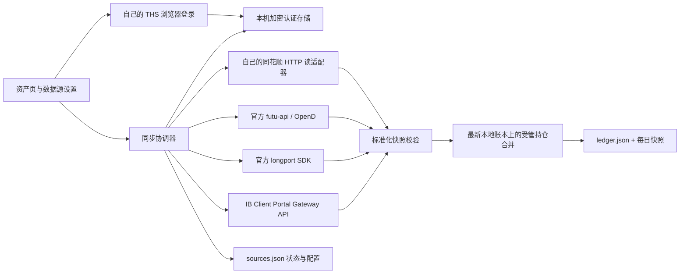

# ADR: 独立资产连接与同步（0.4.0）

用户明确要求只安装资产插件即可使用四家内置来源。0.3.0 对其他 DSH 持仓插件的运行时依赖已移除。

## 结构

## 关键决策

- **独立运行**：同花顺协议与登录代码包含在包中，参考实现保留 MIT 声明但不导入其他插件。富途与长桥依赖锁定的官方库；IB 使用 Node 原生 HTTP(S)。OpenD/Gateway 属于必要的官方账号连接服务，不是 DSH 插件。
- **认证与配置分离**：source 只保存连接标识、账户、周期及状态。credentials 通过独立字段提交，AES-256-GCM 加密落地，密钥和数据采用用户私有目录/权限（Windows 继承用户目录 ACL）。GET/API/模型上下文不返回认证原值。本地加密并不能防御已取得当前用户文件权限的程序。
- **同花顺浏览器会话自有**：新建隔离浏览器和临时配置，使用短期本机调试端口读取限域 Cookie，经账户接口验证再保存。仅管理自己启动的进程；递归清理前校验真实路径与非符号链接。账号或验证码交互由用户在官网完成。
- **重新认证绑定原账户**：已有 THS 连接发起登录时携带 sourceId。保存新 Cookie 前验证新登录仍包含已绑定账本，成功后替换该连接认证；不让旧过期 Cookie 永远覆盖新登录，也不默默切换到另一账号。
- **来源账户直接导入**：原生流程为登录/授权 → 明确选择来源账户 → 导入，不要求预建本地账户，也不提供新建/绑定已有账户的选择。`POST /portfolio/api/sources/connect` 只接收 `{source, credentials?}`，source 不需要 accountId。服务重新验证所选账户属于当前授权，读取并校验首次快照后，在最新账本上同时建立账户、持仓和同步来源。名称与可用币种取官方返回值，缺失显示币种使用本位币；持仓保留原币。
- **去重与失败回滚**：来源账户身份包含平台、稳定账户 ID、富途环境和长桥 App 身份。账户发现返回 imported/sourceId 状态；重复导入复用已有账户，并发同身份请求合并。校验或读取失败不持久化空账户；一般写入异常回滚来源配置并清理新建凭据。配置与账本仍是两个文件，不承诺进程崩溃时的跨文件事务。原生导入不合并手工账户；已有受管持仓后禁止更换来源账户/市场/端点，避免 partial 响应混入另一账号数据。
- **同花顺股票账本与基金账本**：账户发现同时返回 `.common` 股票账本与 `.fund` 基金账本（爱基金 ijj / 手动理财 manFund），原生来源在 `source.thsBookType` 记录账本类型（`common` 默认；`manFund` 用 `fundid`、`ijj` 用 `custid` 调 `merge_fund`）。相同 portfolioId 但不同账本类型视为不同来源，落地账户、来源指纹与去重身份都包含账本类型，避免股票账本与同号基金账本互相覆盖。基金持仓映射为 `assetClass: fund`，成本取单位成本 `percost` 或 `fundcost/fundcount`，现价取净值 `fundnav`，并对份额×净值与来源市值做一致性校验。
- **读取与估值分离**：四家接口仅调用账户、持仓、现金/基金等读操作。不调用登录密码 API、交易解锁、下单或撤单。无现价保留 null，并明确按成本估算。未知成本、数量或不支持的负债/衍生品不填零。原币现金作为单价 1 的持仓，总资产汇总不再重复相加。
- **最新账本提交**：网络读取期间不持有旧账本副本，返回后重新读取本地最新状态，再整批校验合并，保留其他账户的修改。失败不改持仓；partial 不清理缺失项；只有完整快照可删除该来源已消失的持仓。
- **时间水位独立于显示元数据**：记录上传与行情日期的单调水位。来源本轮不提供日期时显示未知，但保留时间水位；更旧日期仍会被拒绝，避免“新快照→无日期→旧快照”的回滚。
- **调度与失败处理**：宿主定期检查到期来源。默认每天 21:00（本机时间），也可设为固定间隔（0 表示仅手动，或正整数分钟）。错过的定时点在下次检查时补跑；该次失败后按退避重试，服务端限流则等到下一个定时点。关闭 DSH 后不执行。同一来源的并发点击合并为一轮读取，卸载中止并阻止提交。
- **高级扩展可选**：HTTP 标准快照和 MCP 是高级选项，四家内置来源不依赖它们。外部 HTTP 仅 HTTPS、本机可 HTTP，GET/禁重定向；MCP 使用公开 tools.execute 保留宿主策略，不绕过审批/PTC。凭据复用前先校验目标，富途账户发现与保存均只允许本机 OpenD。

## 限制与权衡

- 资金与持仓的负数、融资、衍生品以及部分多通道场景当前会拒绝，优先避免组合总额失真。IB 当前限现金现货账户；Longport 多通道现金不能唯一归属时拒绝。
- 长桥提供两种原生接入：官方 MCP（transport `mcp`，授权码兑换 Bearer Token，MCP 地址可自定义，默认官方端点；凭据存 `mcpToken`）与 OpenAPI SDK（transport `native`，App Key/Secret/AccessToken）。来源身份包含通道与（MCP 时）自定义端点；同一长桥账户可用不同接入方式并存。MCP 快照合并 stock_positions/fund_positions/account_balance 并用 quote 批量补现价（失败按成本估值并告警）；SDK 股票持仓接口不含现价，本版不额外订阅行情。0.5.0 的历史回补单独读取同花顺资金流水、富途/长桥官方成交（SDK 与 MCP 路径均支持，MCP 另含资金流水）或账单文件，预览确认后归档，不通过快照路径回放持仓。IB 当前使用文件回补；具体边界、去重与证据见 HISTORY-DESIGN.md。
- 富途同样支持两种接入：官方 MCP（transport `mcp`，浏览器 OAuth 2.1 动态注册 + PKCE + 本地回环回调，凭据存 `mcpToken`/`refreshToken`/`clientId`，MCP 地址可自定义，默认 mcp.futunn.com）与本机 OpenD（transport `native`）。来源身份按 `brokerAccountId`（MCP 为 `acc_id`）区分；`currency` 在 MCP 下为可选，仅用于无标的资金流水的币种归属。MCP 快照合并 account_positions（含现价）与按币种的 account_funds（余额）；多币种资产总额不做汇率折算、只告警省略合计。历史回补 MCP 读取 account_fills_history（按市场分页）+ account_cash_logs（资金流水），无符号时按资金币种或多市场推断并告警。
- 两个 JSON 文件各自原子写，非跨文件数据库事务。极端崩溃可能让状态落后于已保存持仓，下轮全量读取修复。密钥与配置需一起备份并按用户权限保护。
- 浏览器/HTTP/SDK 的上游协议可能变化。自动化验收采用隔离账本、模拟 SDK/网关及真实模块加载，尚需授权账号完成真实登录与读取验收。

## 视觉复用

参考 Monarch 资产总览和账户汇总的信息层级；只适配 BoardUI 免费 MIT 设计变量、圆角、阴影及基础样式。未引入第二份 React 或 Next.js/Tailwind 应用运行时，未使用 Pro 付费源码。客户端仍通过 DSH 自身 React 渲染；样式限定在资产页面，包含深色与窄屏布局。
